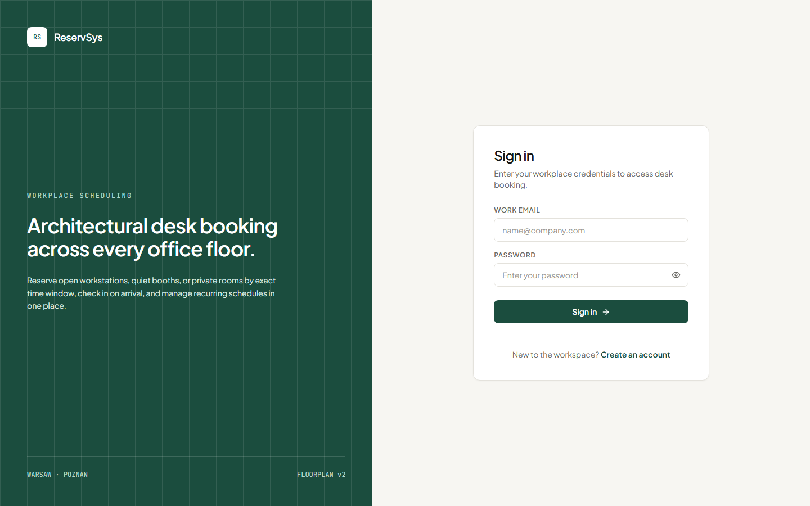
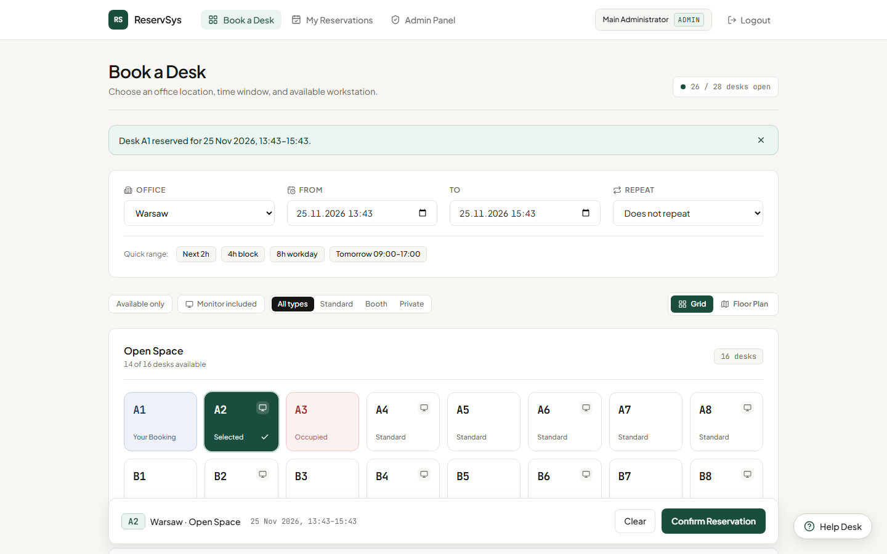
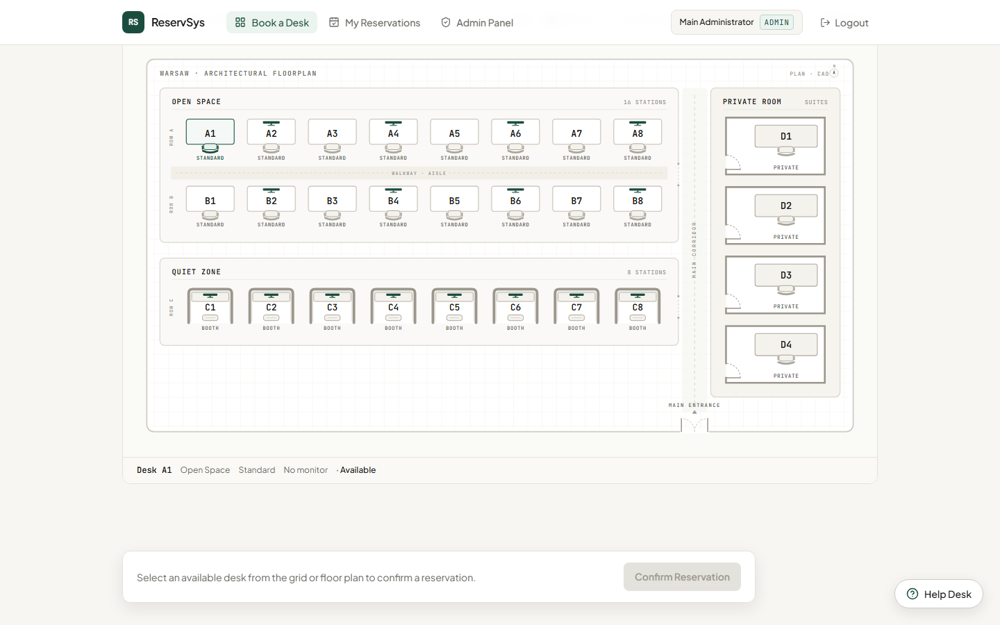
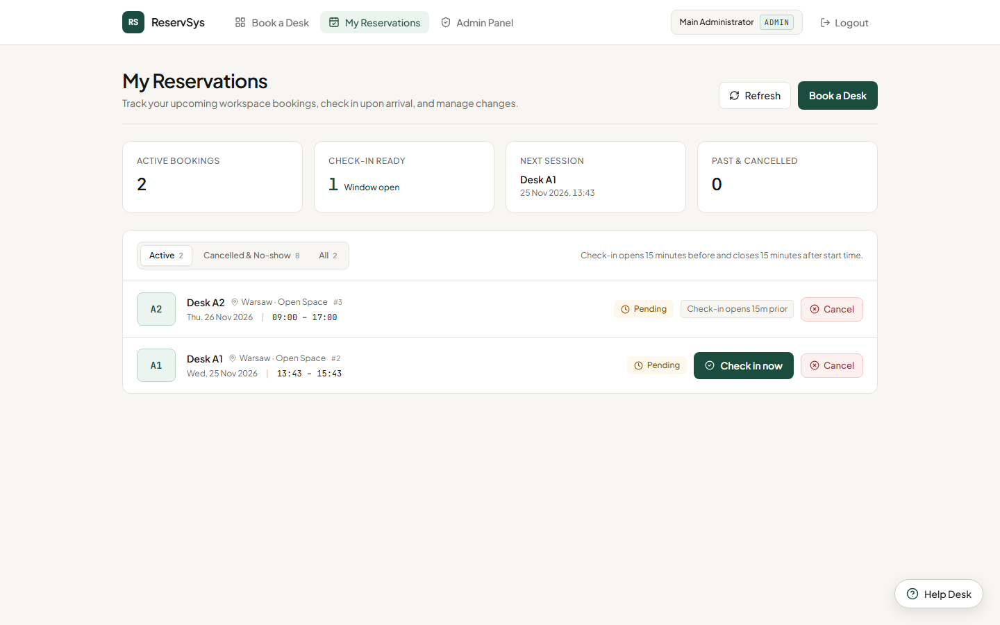
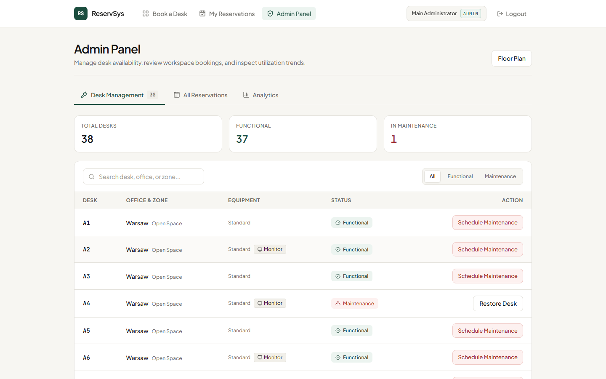
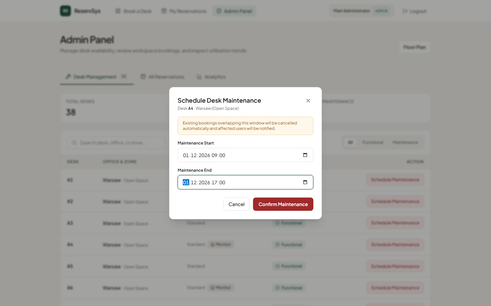
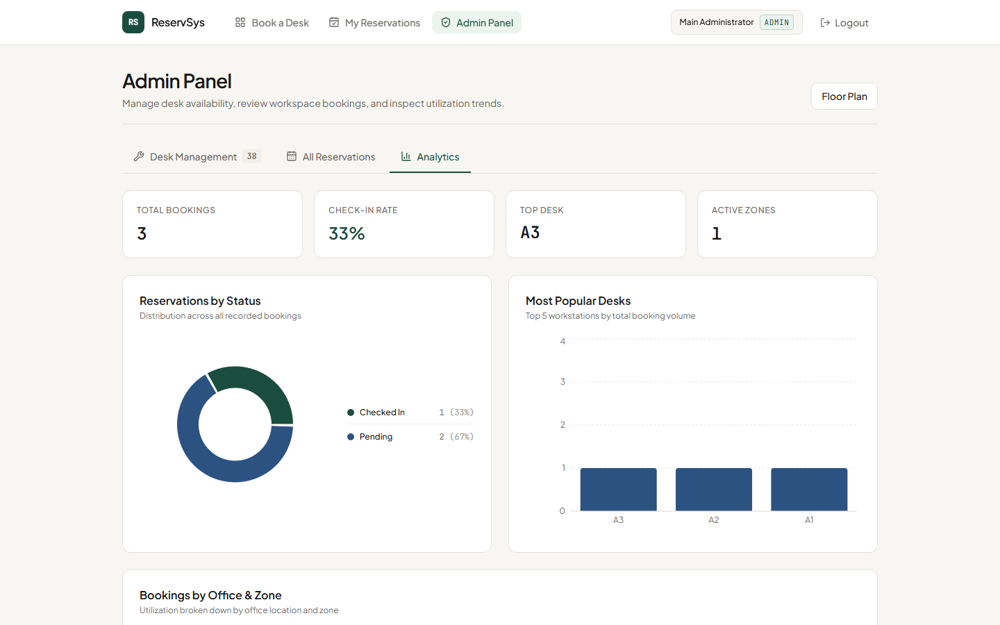

# ReservSys

A full-stack office desk reservation platform with an architectural floor plan viewer, recurring bookings, check-in enforcement, admin maintenance scheduling, analytics dashboards, and a RAG-powered office help desk assistant.

## Tech Stack

| Layer | Technology |
|-------|-----------|
| **Frontend** | Next.js 16 (`^16.4.6`), React 19 (`19.2.4`), TypeScript 5, Tailwind CSS 4, Recharts 3, Lucide Icons, `react-hot-toast` |
| **Backend** | Python 3.11, FastAPI (`0.140.13`), SQLAlchemy 2.0, Alembic, Pydantic v2 (`pydantic-settings`) |
| **Database** | PostgreSQL 15 (Docker), SQLite in-memory (Pytest suite) |
| **Auth & Security** | PyJWT (`HttpOnly`, `SameSite=lax` cookies), `bcrypt`, sliding-window rate limiting |
| **AI / RAG** | LangChain, ChromaDB, HuggingFace Embeddings (`all-MiniLM-L6-v2`), LM Studio (OpenAI-compatible endpoint) |
| **DevOps** | Docker, Docker Compose |

## Features

### For Employees
- **Desk Reservation** — Book workstations across multiple offices (**Warsaw** and **Poznan**) with custom start/end time windows (up to 16 hours per single reservation).
- **Grid & Interactive Floor Plan Views** — Browse desks in a filterable card grid (filter by office, availability, external monitor, and desk type) featuring color-coded vertical status strips, workstation type icons/badges (`Standard`, `Booth`, `Private`), and `Monitor` vs `Laptop-ready` equipment chips—or switch to the interactive architectural CAD SVG floor plan (`OfficeMap`) with zone grouping, desks with monitor & chair silhouettes, U-shaped acoustic booths, walled private suites with door swing arcs, and aisle/corridor framing.
- **Recurring Reservations** — Schedule `daily` or `weekly` recurring bookings (up to 30 occurrences) with atomic all-or-nothing collision validation.
- **Check-in Window** — Check in from **15 minutes before** until **15 minutes after** reservation start time.
- **Personal Dashboard** — Track active bookings and reservation history, check in on arrival, cancel upcoming reservations, and read account notifications.
- **Notifications** — Receive in-app alerts when an administrator cancels a booking, schedules maintenance over an existing reservation, or when a reservation is auto-cancelled as a no-show.
- **Office Help Desk** — Floating RAG chat assistant grounded in office documentation (`backend/docs/office_rules.txt` and `backend/docs/it_helpdesk.txt`).

### For Administrators
- **Desk Management** — Filter and search desks, create new workstations, toggle active/inactive status, and schedule maintenance windows (which automatically cancel overlapping reservations and notify affected employees).
- **Reservation Management** — Inspect paginated reservations across all users and cancel bookings with automatic user notification.
- **Analytics Dashboard** — Interactive Recharts charts displaying:
  - Reservation status breakdown (Donut chart)
  - Most popular desks (Bar chart)
  - Zone occupancy by office (Bar chart)

### System
- **No-Show Auto-Cancellation** — Background `asyncio` task runs every 60 seconds to mark un-checked-in bookings past the 15-minute window as `no_show`, issue in-app notifications, and log simulated email notices.
- **Concurrency-Safe Collision Detection** — Prevents seat and user double-bookings using `SELECT ... FOR UPDATE` row locking and UTC-normalized intervals.

## Screenshots

### 1. Sign In (Split Architectural Layout)


### 2. Desk Reservation — Grid View
Workstation tiles with left vertical status strips, workstation type icons and badges (`Standard`, `Booth`, `Private`), and `Monitor` vs `Laptop-ready` equipment chips, paired with a sticky reservation bar that clears the Help Desk button.



### 3. Desk Reservation — Interactive Architectural Floor Plan
Architectural CAD SVG floor plan (`OfficeMap`) rendering standard desks with monitors and ergonomic chairs, U-shaped acoustic quiet booths, walled private suites with inward door swing arcs, `WALKWAY · AISLE` row dividers, `MAIN CORRIDOR` framing, `MAIN ENTRANCE`, and a `PLAN · CAD` compass.



### 4. Employee Dashboard & Check-In


### 5. Admin Panel — Desk Management


### 6. Admin Panel — Maintenance Scheduling Modal


### 7. Admin Panel — Usage & Occupancy Analytics


## Project Structure

```text
ReservSys/
├── .env.example                     # Environment variable template
├── docker-compose.yml               # PostgreSQL 15, FastAPI backend, Next.js frontend
├── README.md
├── docs/
│   └── assets/
│       └── screenshots/             # UI showcase screenshots
│
├── backend/
│   ├── main.py                      # FastAPI app, CORS, lifespan & no-show background task
│   ├── config.py                    # Pydantic settings & strict SECRET_KEY validation
│   ├── database.py                  # SQLAlchemy engine, session dependency & to_utc() helper
│   ├── models.py                    # User, Seat, Reservation, Notification models
│   ├── api_schemas.py               # Pydantic request/response schemas & validators
│   ├── crud.py                      # Availability queries & collision checks
│   ├── rag.py                       # LangChain + ChromaDB + LM Studio RAG pipeline
│   ├── seed.py                      # Idempotent seeder (Warsaw & Poznan seats + admin user)
│   ├── entrypoint.sh                # Container entrypoint (runs seed.py then uvicorn)
│   ├── Dockerfile
│   ├── requirements.txt
│   ├── alembic/                     # Database migrations
│   ├── routers/
│   │   ├── users.py                 # Register, login, logout, /api/me, notifications, rate limiters
│   │   ├── seats.py                 # Seat creation, availability search, maintenance toggle
│   │   ├── reservations.py          # Booking (single/recurring), listing, cancel, check-in
│   │   ├── admin.py                 # Analytics aggregations
│   │   └── chat.py                  # Rate-limited RAG chat endpoint
│   ├── docs/                        # Knowledge base source documents
│   │   ├── it_helpdesk.txt
│   │   └── office_rules.txt
│   └── test_reservations.py         # Pytest suite (7 tests, in-memory SQLite)
│
└── seat-reservation/                # Next.js 16 App Router frontend
    ├── Dockerfile
    ├── package.json
    ├── next.config.ts
    ├── tsconfig.json
    └── app/
        ├── page.tsx                 # Root redirect (/login)
        ├── layout.tsx               # Fonts, metadata, toast provider
        ├── globals.css              # Design tokens & utility classes
        ├── login/page.tsx           # Sign-in page
        ├── register/page.tsx        # Registration page
        ├── seats/page.tsx           # Desk reservation (Grid + Floor Plan views)
        ├── dashboard/page.tsx       # Employee dashboard & notifications
        ├── admin/page.tsx           # Admin desk management, maintenance modal & analytics
        └── components/
            ├── AppShell.tsx         # Shared responsive header, navigation, user badge & logout
            ├── OfficeMap.tsx        # Interactive SVG office floor plan
            └── HelpDeskChat.tsx     # Floating Office Help Desk RAG widget
```

## Getting Started

### Prerequisites
- [Docker Desktop](https://www.docker.com/products/docker-desktop/) (recommended)
- Or for local development: Python 3.11+, Node.js 20+, PostgreSQL 15+

### Option 1: Docker Compose (Recommended)

1. **Clone the repository and create your `.env` file:**
   ```bash
   git clone https://github.com/Kkacper04/ReservSys.git
   cd ReservSys
   cp .env.example .env
   ```

2. **Configure required secrets in `.env`:**
   - Set `SECRET_KEY` to a random string of at least 32 characters (for example: `python -c "import secrets; print(secrets.token_hex(32))"`).
   - Set strong passwords for `POSTGRES_PASSWORD`, `DATABASE_URL`, and `ADMIN_PASSWORD`.

3. **Build and start all services:**
   ```bash
   docker compose up --build
   ```

   This starts:
   - **PostgreSQL 15** (`reservsys_db`) on host port `5433` (container port `5432`)
   - **Backend (FastAPI)** (`reservsys_backend`) on `http://localhost:8000` (runs `python seed.py` automatically on startup via `entrypoint.sh`)
   - **Frontend (Next.js)** (`reservsys_frontend`) on `http://localhost:3000`

   Open [http://localhost:3000](http://localhost:3000) in your browser.

### Option 2: Local Development

1. **Start PostgreSQL (via Docker):**
   ```bash
   cp .env.example .env
   # Edit .env with a 32+ char SECRET_KEY and your chosen passwords
   docker compose up -d db
   ```

2. **Start the Backend:**
   Note: When running the backend directly on your host against the Dockerized `db` service, configure `backend/.env` with host port `5433` (e.g. `postgresql://<user>:<password>@localhost:5433/<db>`), along with `SECRET_KEY` and `ADMIN_PASSWORD`.
   ```bash
   cd backend
   python -m venv .venv
   .venv\Scripts\activate        # Windows
   # source .venv/bin/activate   # macOS/Linux

   pip install -r requirements.txt
   python seed.py
   uvicorn main:app --reload
   ```

3. **Start the Frontend:**
   ```bash
   cd seat-reservation
   npm install
   npm run dev
   ```

4. **Office Help Desk RAG (Optional):**
   Start [LM Studio](https://lmstudio.ai/) with an OpenAI-compatible local model server on port `1234`. On the first chat query, `backend/rag.py` indexes `backend/docs/*.txt` into `backend/chroma_db/`.

### Seeded Admin Account

`backend/seed.py` seeds the Warsaw and Poznan desks (if the `seats` table is empty) and creates the initial administrator account:

| Role | Email | Password |
|------|-------|----------|
| `admin` | `admin@gmail.com` | Value configured in `ADMIN_PASSWORD` |

## Environment Variables

See [`.env.example`](.env.example) for the full template used by `docker-compose.yml`:

| Variable | Description | Default / Example |
|----------|-------------|-------------------|
| `POSTGRES_USER` | PostgreSQL username | `admin` |
| `POSTGRES_PASSWORD` | PostgreSQL password (required) | Set a strong password |
| `POSTGRES_DB` | PostgreSQL database name | `reservation_system` |
| `DATABASE_URL` | SQLAlchemy connection string (required) | `postgresql://<user>:<password>@db:5432/reservation_system` |
| `SECRET_KEY` | JWT signing key (required, min 32 chars, no placeholder) | 32+ byte hex string |
| `ALGORITHM` | JWT algorithm (`HS256`, `HS384`, or `HS512`) | `HS256` |
| `ALLOWED_ORIGINS` | Comma-separated CORS origins (wildcards ignored) | `http://localhost:3000,http://127.0.0.1:3000` |
| `COOKIE_SECURE` | Set `Secure` flag on auth cookie (`true` in HTTPS prod) | `false` |
| `ADMIN_PASSWORD` | Password for seeded admin user (required by `seed.py`) | Set a strong password |
| `LM_STUDIO_URL` | OpenAI-compatible LLM base URL for Help Desk RAG | `http://host.docker.internal:1234/v1` |
| `NEXT_PUBLIC_API_URL` | Backend base URL used by the Next.js frontend | `http://localhost:8000` |

## API Endpoints

### Health
| Method | Endpoint | Access | Description |
|--------|----------|--------|-------------|
| GET | `/` | Public | API health check |

### Authentication & User Profile
| Method | Endpoint | Access | Description |
|--------|----------|--------|-------------|
| POST | `/api/register` | Public (10 req/min) | Register an employee account (normalizes email, validates password ≤72 bytes) |
| POST | `/api/login` | Public (20 req/min) | Authenticate and set `HttpOnly`, `SameSite=lax` JWT cookie |
| POST | `/api/logout` | Public | Clear the `access_token` cookie |
| GET | `/api/me` | Authenticated | Return current authenticated user (`id`, `name`, `email`, `role`) |
| GET | `/api/me/notifications` | Authenticated | List unread notifications for the current user |
| PATCH | `/api/me/notifications/{notification_id}/read` | Authenticated | Mark a user notification as read |

### Seats
| Method | Endpoint | Access | Description |
|--------|----------|--------|-------------|
| GET | `/api/seats/available` | Public | Get seats with `is_available` and `is_active` for `start_time`–`end_time` |
| POST | `/api/seats/` | Admin | Create a new seat |
| PATCH | `/api/seats/{seat_id}/toggle` | Admin | Toggle active status or schedule a maintenance window (`maintenance_start`, `maintenance_end`), cancelling overlapping bookings and notifying users |

### Reservations
| Method | Endpoint | Access | Description |
|--------|----------|--------|-------------|
| POST | `/api/reservations/` | Authenticated | Create single or recurring (`daily` / `weekly`, max 30) reservation |
| GET | `/api/reservations/` | Admin | List all reservations (`skip`, `limit` pagination) |
| GET | `/api/reservations/my` | Authenticated | List current user's reservations (`skip`, `limit` pagination) |
| DELETE | `/api/reservations/{reservation_id}/cancel` | Admin | Cancel any reservation and notify the owner |
| PATCH | `/api/reservations/{reservation_id}/my-cancel` | Authenticated | Cancel own `pending` or `confirmed` reservation |
| PATCH | `/api/reservations/{reservation_id}/checkin` | Authenticated | Check in within ±15 minutes of reservation start time |

### Admin & Help Desk
| Method | Endpoint | Access | Description |
|--------|----------|--------|-------------|
| GET | `/api/admin/analytics` | Admin | Reservation status breakdown, top 5 popular desks, and zone occupancy by office |
| POST | `/api/chat/` | Authenticated (20 req/min) | Query the office knowledge base via RAG |

## Security Highlights

- **Strict Secret Enforcement** — Startup fails fast if `SECRET_KEY` is missing, shorter than 32 characters, or left as a placeholder; `DATABASE_URL` and `ADMIN_PASSWORD` likewise have no hardcoded fallback defaults.
- **HttpOnly Cookie Authentication** — JWTs (validated against `HS256`/`HS384`/`HS512`) are issued exclusively in `HttpOnly`, `SameSite=lax` cookies with configurable `COOKIE_SECURE`.
- **RBAC Dependencies** — `get_current_user` and `require_admin` enforce authentication and admin authorization across protected endpoints.
- **Sliding-Window Rate Limiting** — Thread-safe per-IP rate limiters protect `/api/login` (20/min), `/api/register` (10/min), and `/api/chat/` (20/min).
- **UTC Normalization & Atomic Locking** — All incoming timestamps are normalized to UTC via `to_utc()`, and seat booking uses `SELECT ... FOR UPDATE` row locking and single-transaction commits for recurring series.
- **Hardened CORS** — Wildcard origins (`*`) are filtered out of `ALLOWED_ORIGINS`, restricting `allow_credentials=True` to explicit origins, methods, and headers.

## Testing & Verification

### Backend Tests (`pytest`)
Tests run against an isolated in-memory SQLite database and do not require PostgreSQL:

```bash
cd backend
pytest test_reservations.py -v
```

Covers 7 test suites: time-range validation, overbooking collision prevention, maintenance window UTC timezone handling, auth & cookie flags, RBAC & malformed JWT rejection, atomic recurring reservations & inactive seat checks, and check-in/cancel state transitions.

### Frontend Checks
```bash
cd seat-reservation
npx tsc --noEmit
npm run lint
npm run build
```

## License

This project is intended for educational and portfolio purposes.
